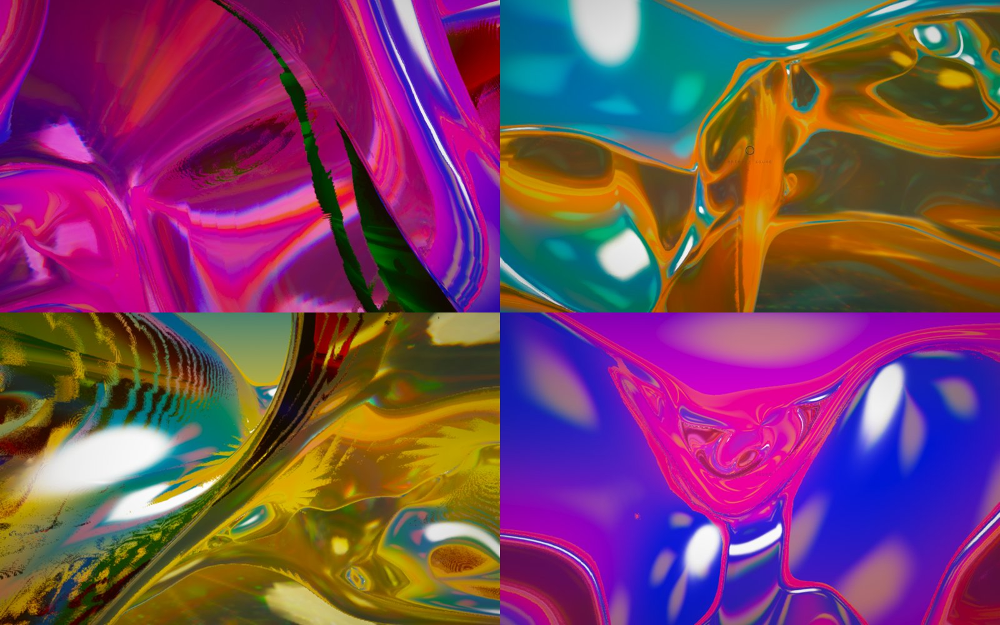
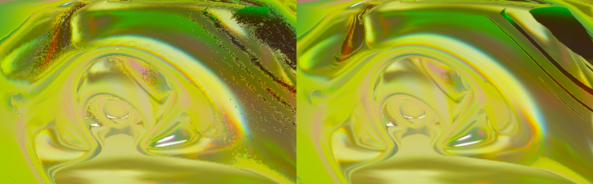
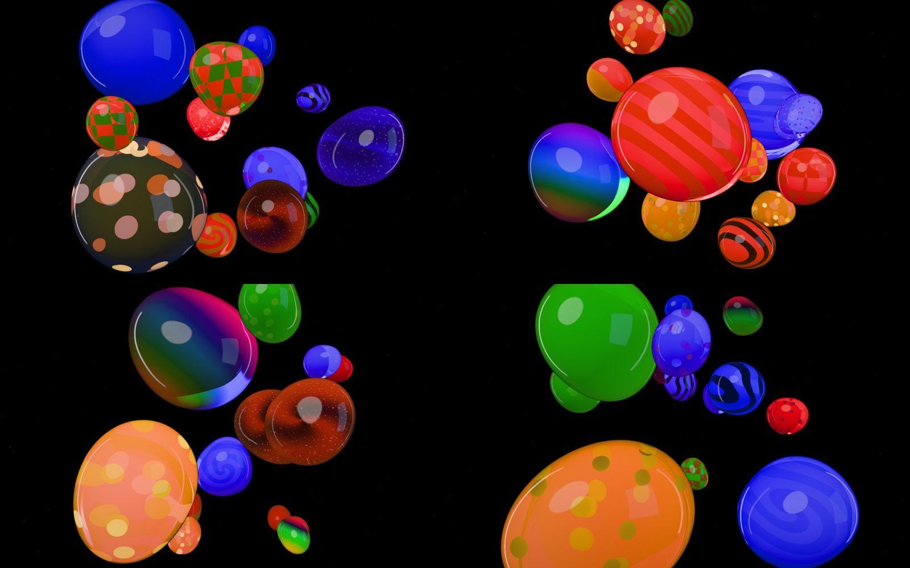

# xiuxiueig

Interactive 3D artworks made of jelly light and generative sound.
*Xiuxiueig* is Catalan for "whisper" (pronounced roughly *shyoo-shyoo-aitch*).

Both pieces run in the browser (WebGL2 + AudioWorklet). You steer by leaning
with the pointer: you always drift forward, and the pointer's offset from the
centre sets your heading, climb and speed through springy, slightly
overshooting motion.

---

## Piece 1: *unknowable, unspeakable, unarticulable*

An endless field of jelly membranes in psychedelic colour that never repeats,
over a silver floor of caustic light, with a drone built from the overtones of
struck glass.



- **Design:** a fictional workshop between three invented artists, a
  Sculptor, a Printmaker and a Kineticist
  ([transcript](piece-1/docs/design/workshop.md)), and the
  [brief](piece-1/docs/design/brief.md) it produced.
- **World:** triply periodic minimal surfaces (gyroid, Schwarz D and Schwarz P),
  domain-warped by a Benjolin chaos clock. Minute-scale "eras" with
  incommensurate periods morph surface family, cell size, turbulence,
  thickness, colour depth and light angle.
- **Light:** the jelly optics of [Jelly Baby](https://github.com/scottstts/Jelly-Baby)
  (IOR 1.35, Fresnel, Beer–Lambert flavour absorption, area-ratio caustics),
  reimplemented, plus per-channel dispersion. The field is baked into a 3D
  texture each frame, with temporal anti-aliasing (jittered and reprojected)
  on top.
- **Sound:** a Rust/WASM drone using DSP modules from
  [JP-8](https://github.com/boxabirds/jp8): six voices gliding between glass
  partials, rare glint swells ringing a wine-glass resonator, and BBD chorus.
  It's coupled both ways to the picture, sharing one breath, wobble and
  misregistration signal set.



## Piece 2: *jelly asteroids*

Fly through black space among giant jelly sweets, lit by a studio that travels
with you. They squash when they touch, merge for good, and wobble.



- **Brief:** [piece-2/docs/design/brief.md](piece-2/docs/design/brief.md).
- **Look:** after Unix Jelly's jelly. Round studio highlights, colour that
  deepens through thick jelly, inner glow and rim, Neutral tone mapping. All
  twelve jar looks: patterns layered inside the jelly (zebra, stripy, swirly,
  checked, two-tone, rainbow) or bits suspended in it (chocolate chips,
  sprinkles, glitter, galaxy stars, gold leaf).
- **Physics:** each jelly is an XPBD soft body (a 162-particle shell with
  shape matching and edge constraints). Every frame, its shape is fitted to
  real spherical harmonics up to l = 4, and the renderer and the collisions
  both use that surface. Bumps squash, stick, then melt into one jelly via a
  growing smooth union, conserving volume and momentum. Flying into a jelly
  parts it around you.
- **Sound:** a Rust/WASM engine. Each jelly has a smooth drone voice pitched by
  its size, snapped to a harmonic series, with per-voice harmonic recipes.
  Contacts make squelchy squishes, and every merge plops like a water drop
  (rising bubble resonance). A merged jelly's pitch slides down.

---

## Running

The landing page (`index.html`) links to both pieces. Any static server at the
repository root serves the whole site, with no build step:

```bash
python3 -m http.server 5181   # then open http://127.0.0.1:5181
```

To work on a piece with live reload:

Each piece is self-contained. You need Node, bun (or npm) and, to rebuild the
sound engines, Rust with the `wasm32-unknown-unknown` target. The compiled
`.wasm` files are committed.

```bash
cd piece-1 && bun install && npm run dev    # http://127.0.0.1:5179
cd piece-2 && ln -s ../piece-1/node_modules node_modules && npm run dev    # http://127.0.0.1:5180
```

Click the small ring to enter (sound on). Move the pointer to lean. Press `M`
to mute.

## Testing

```bash
cd piece-1 && npm test                         # Rust DSP (incl. zero-allocation proof) + JS viewer/score/eras
cd piece-2 && npm test && npm run test:rust    # spherical harmonics, XPBD physics, population, sound mapping, audio engine
npm run test:browser                           # in either piece, with its dev server running: real Chrome + GPU smoke test
```

The browser tests drive the installed Google Chrome through Playwright on the
real GPU. Beyond the smoke tests, there are image-quality and audio probes:
colourfulness and contrast, floor sparkle and flicker, speckle, and live
audio levels.

## Credits and licence

GPL-3.0 (see [LICENSE](LICENSE)).

- The optical model follows Scott Sun's **Jelly Baby** (GPL-3.0) and the jelly
  look follows **Unix Jelly** (GPL-3.0). Their techniques and parameters are
  reimplemented in the pieces' shaders.
- DSP modules in `piece-1/engine/crates/xiu-dsp` are copied from **JP-8**
  (Apache-2.0, compatible with GPL-3.0), each file with a provenance header.
- [`vendor/`](vendor/) holds pinned reference copies of the upstream files from
  all three, with their licences and commit hashes.
- XPBD after Macklin, Müller and Chentanez (2016). Rotation extraction after
  Müller et al. (2016).
